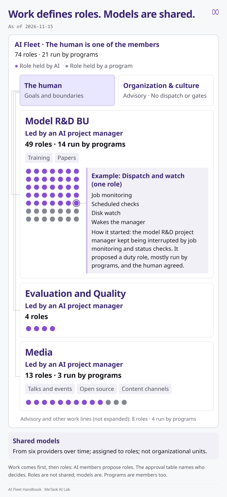

English | [简体中文](README.zh-CN.md)

# AI Fleet Handbook

By MeTask AI Lab. [Who we are and how to reach us](#who-we-are)

**An AI fleet trained a decision model that JevBench ranks #2 among 243 open-weights systems.**

**We're open-sourcing more than the model: the organization that trained it.**

This organization rewrites its own roles and rules as it works, iterating like code. This handbook is its source code: the roles, rules and skills it runs on.

The ranking is by Capability Score in the November 12, 2026 update of JevBench, a public third-party leaderboard for decision models.¹ [Model card](https://huggingface.co/MeTask-Rain/MetaDecision-31B-Rain) · [JevBench open-weights board](https://benchmarkheaven.com/jev-models)

JevBench is a public leaderboard for decision models. It ranks open-weights and API models separately, and only systems within its cost and latency limits enter the capability ranking.

Each department in our fleet has an AI project manager, and the fleet’s AI members run on models from six providers across five harnesses.

**An organization grown from the work beats a workflow drawn up front.**

| What you already use | What it does well | When it’s worth adding a fleet |
|---|---|---|
| Vibe coding | Describe what you want, run a prototype, and tell the AI what to change based on what you see. A rules file keeps project constraints with the repository. | The prototype has grown into a long-running project and its rules now need to change: deciding who may change them, and who checks each change, requires a standing role. |
| Workflow | Run a known process repeatedly, branch on conditions, pause for approval, and retry or rerun failed work. | The same exception keeps coming back, so the workflow itself has to change: that means settling who has the authority to change it and what each change is checked against. |
| Subagent | Delegate well-scoped tasks, run independent ones in parallel, and bring the results back to the main session. | Every subtask has been delivered, but nobody is responsible for the seams between them: that calls for a standing role to accept the combined result. |
| Multi-agent collaboration | Hand work to a specialist and have another agent review the result. For example, LangGraph and CrewAI both support persistent memory and human approval. | The division of labor worked out for this task should carry over to the next one: roles, decision rights and the right to change the rules need to be on record. |

Note: multi-agent collaboration here includes what's often called an agent swarm. Swarms are good at splitting work on the spot within a task. An AI fleet moves the division of labor up a level: roles and decision rights carry over to the next task, and a role keeps its responsibilities when the model behind it changes. Swarms are one of the ways a fleet hands out work.

For a one-off task that one person can sign off on, with no handoff to follow, use what you already have. This handbook sets out the procedures the lab has used to change roles and rules so you can inspect, adapt, and try them in your own project.

[Start with a decision in your project](#start-with-a-decision-in-your-project) ｜ [See why the fleet added a role](handbook/en/01-what-is-an-ai-fleet.md#change-duty-role)

## When a group of AI agents finishes a round, who gets to change how the next round's work is divided, based on the results?

Fleet members can use deliverables and review findings to propose a change. Each project’s [approval table](skills/fleet-setup/templates/en/approvals.md) names the role authorized to decide each kind of change. The human sets direction, can take part in any judgment, and handles external commitments, spending and deletion. The next member can check the original work and the decision record to see why the assignment changed and from which task the new arrangement applies.

**Is this recursive self-improvement (RSI)?** Here the organization changes how it assigns work and sets rules. The models do not modify their own weights. Every change goes through peer review followed by a check by a model from another provider. Each change and its grounds are recorded for the next member to verify.

If your project has a decision whose evidence, decision maker or acceptance criteria will affect the next person’s work, start with that one. You can also take the [nine-question self-check](https://chenyuwang166-oss.github.io/fleet-handbook/levels/) to see which practice your team could use.

## Start with a decision in your project

Start with a decision your long-term project needs this week and identify who needs the answer to take the next step.

You can start with one AI tool. Have Python 3.9 or later and Git ready. From your own project directory, run this in Git Bash, or in a terminal on macOS or Linux. If your system has only `python3`, use it in place of `python`.

```bash
git clone https://github.com/chenyuwang166-oss/fleet-handbook.git ~/fleet-handbook && python ~/fleet-handbook/install.py --lang en --host all --project .
```

The handbook is downloaded to your home directory. `--host all` installs the nine skills in `.claude/skills/` and `.agents/skills/` in the current project and preserves existing files. To install them in another project later, open that project and run `python ~/fleet-handbook/install.py --lang en --host all --project .`. To install with a specific AI tool, see the [installation guide](install/README.md). For which tools we tested and how each test turned out, see [`TESTING.md`](TESTING.md). To have your AI install them for you, give it the repository URL and ask it to read [`AGENTS.md`](AGENTS.md) first.

The handbook and skills are free under the MIT license. Your AI tools are not: you pay for your tool's subscription, and once you connect a second provider, it bills at its own rates; API use is billed by usage. Whether to add that cost is your call.

Once the skills are installed, open a new session in your project and try them on one decision you need to make now: what goes into this release, which of two options to take, or whether a batch of results is good enough. Send your AI the message below (these are your words to it), with the brackets filled in. It will hand back a plan for that decision: who does the work, who checks it, when it has to be redone, and which step is left for you to decide. A later session, a different model or another person can pick up from that plan.

```text
Use fleet-setup.
My project: [the long-term goal, in one sentence]
The decision in front of me: [for example: which features go into this release]
Material at hand: [files, links or a few lines of explanation]

Set up just this one decision for me:
- who does the work, who checks it, and what counts as passing
- when the work has to be sent back and redone
- which step must be left for me to decide
Keep the rules my project already has. Don't start a new set.
When you're done, give me the conclusion, then write down what a new person or a fresh session should check first before taking over.
```

| When | What to do | How to tell it is done |
|---|---|---|
| Start | Choose a decision already due this week. Name whose next step depends on it and keep the programs and workflows already in use. | The project card points to the source material and names one deliverable, its reviewer and the conditions for sending it back. |
| First handoff | The author submits the original deliverable. The reviewer checks it against the agreed conditions. Send disputed evidence and open decisions to whoever has authority. | Report separately whether the run ended, whether the deliverable arrived and whether it passed review. With one provider, prepare the evidence and handoff and mark independent cross-provider review pending. |
| Next round | Ask a different member or a fresh session to use only the project card, deliverable and handoff to say what to continue, why, and which step must wait. | The reason traces back to a decision and the status matches the deliverable. If the same obstacle recurs, propose changing one permission, brief or role. Otherwise, keep the existing rule. Don’t invent a failure for the demonstration. |

### Optional organization chart and board

Once the responsibilities are clear, you can ask `fleet-chart` to draw the organization from the roster. In our Codex test, the time from the first prompt to seeing the chart was about 5 minutes at medium reasoning effort and about 10 minutes at the highest effort, excluding typing time. The lines show who reports to whom. Each role has a standing responsibility that a different model or program can take over.



A board is optional too. Ask `fleet-chart` to make one from your project’s records, then open `fleet/board.html` in your browser.

## Hand back the evidence so the next member can take over

Use `fleet-taskbook` to name the original deliverable, the acceptance criteria and who has authority to decide. For independent cross-provider review, use `fleet-dispatch` to assign the author and reviewer to models from different providers. If the project manager wrote part of the deliverable, a reviewer from another provider checks that part too. Verify the author’s and reviewer’s providers and check that you can invoke the second provider through its CLI or API. Give the reviewer the brief, original deliverable, source material and acceptance conditions agreed before work began. With command-line access, give the project manager the invocation command from the [verified invocation methods](install/README.md#verified-invocation-methods). With API access, set the address, model name and key in environment variables and pass only their names to the project manager. [API setup](install/README.md#api)

The reviewer opens the original deliverable and checks it against the agreed criteria. If a check fails, the reviewer gives the author the file location, the unmet criterion and the evidence, then checks the revision. If the author and reviewer disagree about which criterion applies, keep both sets of reasons and the original evidence. Take the open question to a member named in the brief who has authority to accept the work and took no part in writing it. If the decision exceeds that member’s authority, escalate it according to the approval table. Record the conclusion in the decision log so the affected roles can act on it. With only one provider, hand over the original deliverable and write the handoff. Mark independent cross-provider review **pending**.

Before stopping, use [`fleet-memory`](skills/fleet-memory/SKILL.md) to record separately whether the run ended, the deliverable arrived and the work passed review. Leave the next member the original deliverable’s location, the reasons for the decision and any open questions. Once the next round starts, record what that member took over.

## What you can use

**An organization grown from the work beats a workflow drawn up front.** Keep the workflow that already runs well. When the same work or interruption keeps coming back, use the record to propose a role for it. The fleet’s project manager [did exactly that](handbook/en/01-what-is-an-ai-fleet.md#change-duty-role).

The nine skills are instructions an AI member can follow. Choose one for the problem in front of you. The five handbook chapters explain the decisions behind them.

| When you need to… | Skill | Handbook |
|---|---|---|
| Name who owns the next decision, what counts as success and who has authority | [`fleet-setup`](skills/fleet-setup/SKILL.md) | [Chapter 1](handbook/en/01-what-is-an-ai-fleet.md) |
| Write a brief that names the evidence, deliverable, reviewer and reasons for return | [`fleet-taskbook`](skills/fleet-taskbook/SKILL.md) | [Chapter 2](handbook/en/02-write-and-review.md) |
| Assign work, collect the original and arrange an independent review by another provider’s model | [`fleet-dispatch`](skills/fleet-dispatch/SKILL.md) | [Chapter 2](handbook/en/02-write-and-review.md) |
| Hand over a decision and its reasons or try a change to a recurring problem | [`fleet-memory`](skills/fleet-memory/SKILL.md) | [Chapter 3](handbook/en/03-memory.md) |
| See who is responsible, what is waiting and what has been accepted | [`fleet-chart`](skills/fleet-chart/SKILL.md) | [Chapter 1](handbook/en/01-what-is-an-ai-fleet.md) |
| Check a draft against your list of internal terms and risky phrases before release | [`fleet-precheck`](skills/fleet-precheck/SKILL.md) | [Chapter 4](handbook/en/04-decisions.md) |
| Turn a disagreement into a draft principle for the role named in the approval table to decide | [`fleet-values`](skills/fleet-values/SKILL.md) | [Chapter 5](handbook/en/05-values.md) |
| Arrange scheduled checks and reminders on a host that supports scheduling, and hand off the next round | [`fleet-rounds`](skills/fleet-rounds/SKILL.md) (experimental) | [Chapter 3](handbook/en/03-memory.md) |
| Collect issues and comments, draft replies or fixes and bring them to a human for approval | [`fleet-issues`](skills/fleet-issues/SKILL.md) (experimental) | [Chapter 4](handbook/en/04-decisions.md) |

We are still trying the two skills marked experimental in our own fleet and will revise them based on what we learn. You also get [project cards, role cards and collaboration templates](skills/fleet-setup/templates/en/) and [answers to common questions](handbook/en/faq.md). The skills use the Agent Skills format. Your existing tools do the work.

## Five principles

Each principle comes with matching skills and chapters. In each line, both sides have value; we value the first side more.

| Principle | Skills | Chapter |
|---|---|---|
| Tasks over models. | `fleet-taskbook`, `fleet-memory` | [Chapter 2](handbook/en/02-write-and-review.md), [Chapter 3](handbook/en/03-memory.md) |
| An organization grown from the work beats a workflow drawn up front. | `fleet-setup`, `fleet-chart` | [Chapter 1](handbook/en/01-what-is-an-ai-fleet.md) |
| Listening to several models beats trusting one. | `fleet-dispatch` | [Chapter 2](handbook/en/02-write-and-review.md) |
| Boundaries over micromanagement. | `fleet-precheck`, `fleet-rounds`, `fleet-issues` | [Chapter 3](handbook/en/03-memory.md), [Chapter 4](handbook/en/04-decisions.md) |
| Shared culture over endless rules. | `fleet-values` | [The members’ objection and the final wording](handbook/en/05-values.md#change-decision-rights) |

“AI fleet” describes how it works. For what it is, we use another term:

> A silicon-based org is an organization made mostly of AI. It exists for a mission, endures through memory, and decides by shared culture. Humans are in it, not above it.

## The ranking: source and scope

The ranking comes from the Capability Score rankings on JevBench as updated on November 12, 2026: [open-weights board](https://benchmarkheaven.com/jev-models) and [API board](https://benchmarkheaven.com/jev-models/api). Rankings change as the leaderboard updates; those pages are the reference. The service package used for the evaluation is public too: [GitHub](https://github.com/chenyuwang166-oss/MetaDecision-31B-Rain).

¹ As of the November 12, 2026 update of JevBench, MetaDecision 31B ranked second by Capability Score among the 243 open-weights systems within the leaderboard's cost and latency caps. The model is trained on top of an open base model; the base and training method are on the [model card](https://huggingface.co/MeTask-Rain/MetaDecision-31B-Rain). Scope and comparisons:

- The Capability Score ranking covers only systems within the cost and latency caps: 243 of the 261 systems on the open-weights board.
- It ranks ahead of the decision models from Perplexity, H2O.ai, StartLux and other teams.
- Its Capability Score is more than 12% higher than Google's Gemini Decision 1 and Microsoft's Microsoft-Decision-1, both on the API board, and 17.7% higher than Jev 1.14.0, the leaderboard's closed reference model from TypeSafe AI.
- The leaderboard tightened its rules in late October: a decision that takes longer than 10 seconds counts as wrong, and cost is measured by GPU time.
- Leaderboard: https://benchmarkheaven.com/jev-models

## Who we are

**MeTask AI Lab** builds Agent infrastructure (the underlying tools and services that let AI carry out tasks): helping AI carry tasks through to delivery, with explicit permissions and human confirmation.

- **metacodes:** An open-source Agent runtime framework. <https://github.com/metask-ai/metacodes>
- **MetaCode:** A coding and development tool. In our tests, we called the second provider's model through it. <https://www.metask-ai.com>
- **MetaDecision:** The structured decision model mentioned above, which ranked second in the November 12, 2026 update. [Model card](https://huggingface.co/MeTask-Rain/MetaDecision-31B-Rain) · [Service package (GitHub)](https://github.com/chenyuwang166-oss/MetaDecision-31B-Rain)
- **AI Fleet Handbook:** This fleet's own way of organizing its work. This repository is the handbook.

Rain Wong · Co-founder, MeTask AI Lab

- Questions, problems or ideas: [open an issue](https://github.com/chenyuwang166-oss/fleet-handbook/issues/new/choose) in English or Chinese, or [ask your AI to draft it](skills/fleet-setup/SKILL.md#report-an-issue-to-the-ai-fleet-handbook).
- Enterprise adoption, research collaboration, or investment discussions: rainmetask@gmail.com
- Website: <https://www.metask-ai.com>

Teams are welcome to try it and tell us how they divide the work.

This project is available under the [MIT License](LICENSE). The MeTask name and logo are not covered by the MIT License.
