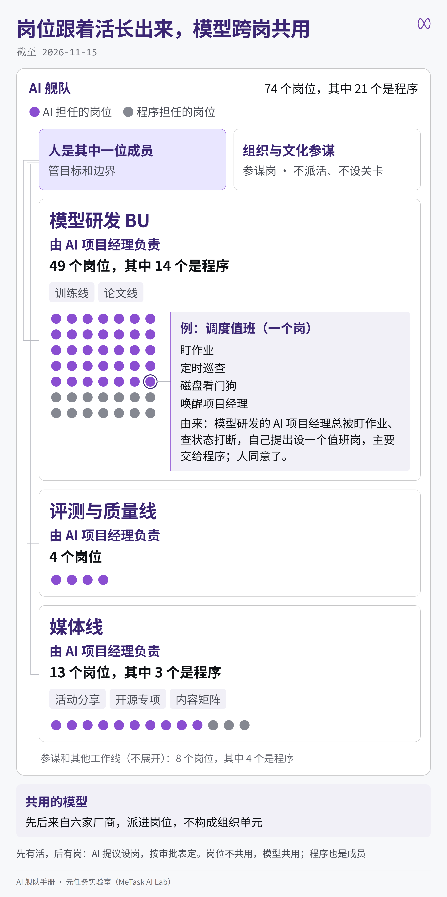

[English](README.md) | 简体中文

# AI 舰队手册

元任务实验室（MeTask AI Lab）出品。[我们是谁，怎么联系](#我们是谁)

**一个 AI 舰队组织，训出了全球第二的开源决策模型。开源的不止是模型，还有这个组织本身。** 它边做事，边改写自己的分工和规矩，像代码一样迭代。这本手册就是它的源码。

这支舰队训出的结构化决策模型，据公开的第三方决策模型评测榜 JevBench 2026 年 11 月 12 日的更新，在 243 个开源权重系统中能力分排第 2¹。[模型卡](https://huggingface.co/MeTask-Rain/MetaDecision-31B-Rain) · [查 JevBench 开源榜](https://benchmarkheaven.com/jev-models)

JevBench 是公开的决策模型评测榜：开源权重和 API 模型分开排，成本和延迟都在上限内的系统才进能力分排名。

这支舰队各部门的项目经理是 AI；成员背后是六家厂商的模型、五种 harness。

**长出来的组织，胜过画出来的工作流。**

| 已经在用的 | 它擅长什么 | 什么时候值得加一支舰队 |
|---|---|---|
| vibe coding | 描述想要的效果，跑一版原型，再看着结果让 AI 改。规则文件能让约束跟着仓库走。 | 原型做成了长期项目，规矩开始要改：谁能改、改了谁来验，需要固定的岗位。 |
| 工作流（workflow） | 让已知步骤重复运行，按条件分支，需要时等审批，失败后重试或重跑。 | 同一种例外一再出现，要改的是流程本身：谁有权改、改了怎么验，需要定下来。 |
| 子代理（subagent） | 把范围明确的子任务分出去，独立的部分可以并行，结果交回主会话汇总。 | 子任务都交了，衔接的地方没人负责：需要一个常设的岗位来验收。 |
| 多智能体协作（multi-agent collaboration） | 按专长交接任务，让另一名成员评阅产出。例如 LangGraph、CrewAI 都支持持久记忆和人工审批。 | 这一项任务分好的工，下一项还想接着用：岗位、拍板权和改规矩的权，需要留下记录。 |

注：表里的"多智能体协作"，也包括现在常说的蜂群（swarm）。蜂群擅长在一项任务里现场分工；AI 舰队组织把分工往上提了一级：岗位和拍板权留到下一项任务，换了模型，岗位的职责还在。蜂群也是舰队派活的一种方式。

一次性的活，一个人就能验收，也没有下一位接手，用手头的做法就好。这本手册把实验室用过的分工和改规矩的办法公开出来，供你查看、修改，拿自己的项目试。

[从你项目里的一个决定开始](#从项目里的一个决定开始) ｜ [看舰队怎样改过一次分工](handbook/zh/01-what-is-an-ai-fleet.md#change-duty-role)

## 一群 AI 做完上一轮，谁有权根据结果改变下一轮的分工？

成员可以拿交付和审核意见提议改分工。哪类改动由哪个岗位定，写在项目的[审批流](skills/fleet-setup/templates/zh/审批流.md)里。人定方向，可以随时参与判断，也管对外承诺、花钱和删东西。接手的人可以对着原件和决定记录，查到为什么改、从哪一项任务开始照新办法做。

**这是递归自我改进（RSI）吗？** 这里改的是组织怎么分工、怎么定规矩。模型不会自己修改权重。每一处改动都过多级审核：同伴互审，再换一家模型复核。每一处都记下改了什么、依据是什么，留给下一位核对。

如果你的项目里有这样一个决定：用什么证据、由谁来定、按什么条件验收，会影响下一步用这个结论的人怎么干，就从它开始。想先看看自己的团队还缺哪项做法，可以做[九道题自测](https://chenyuwang166-oss.github.io/fleet-handbook/levels/)。

## 从项目里的一个决定开始

先从长期项目里挑一件本周就要决定的事，找出下一步要用这个结论的人。

手册和技能按 MIT 许可，免费用；AI 工具本身不免费：你自己的工具要付订阅，接上第二家模型以后，它按自家的价格计费，走接口的按用量收费。加不加这笔钱，由你定。

一个 AI 工具就能开始。备好 Python 3.9 或更高版本和 Git，在自己的项目目录里用 Git Bash、macOS 或 Linux 终端运行下面的命令。系统里只有 `python3` 的，把 `python` 换成 `python3`。

```bash
git clone https://github.com/chenyuwang166-oss/fleet-handbook.git ~/fleet-handbook && python ~/fleet-handbook/install.py --lang zh --host all --project .
```

手册会下载到主目录。`--host all` 把九个技能装进当前项目的 `.claude/skills/` 和 `.agents/skills/` 两个文件夹，不动项目里别的文件，也不覆盖已有文件。以后给别的项目装，在那个项目里运行 `python ~/fleet-handbook/install.py --lang zh --host all --project .`。

各种 AI 工具上具体怎么装，见[安装说明](install/README.zh-CN.md)。我们实际测过哪些工具、各测了哪些环节、结果怎样，见[实测记录](TESTING.zh-CN.md)。也可以让 AI 来装。把仓库地址发给它，请它先读仓库根目录的 [`AGENTS.md`](AGENTS.md)。

装好后，在你的项目里新开一个会话，拿眼下要拍板的一件事来试，比如这一版做什么、两个方案选哪个、这批结果算不算合格。把下面这段话发给你的 AI（这是你对它说的话），方括号里换成自己的内容。它会交回一张安排：这件事谁来做、谁来验、什么情况要重做、哪一步留给你拍板。以后换会话、换模型、换人，都凭这张安排接着干。

```text
用 fleet-setup。
我的项目：［一句话说清长期目标］
眼下要拍板的事：［比如：这一版先做哪些功能］
手头的材料：［文件、链接或几句说明］

只帮我把这一件事安排清楚：
- 谁来做，谁来验，凭什么算通过
- 什么情况要退回重做
- 哪一步必须留给我拍板
项目里已经定过的规矩先照用，别另起一套。
做完把结论给我，再写清楚：换个人或新开一个会话接手时，要先核对哪几件事。
```

| 何时 | 要做什么 | 怎样知道做完 |
|---|---|---|
| 开工 | 挑一个本周本来就要做的决定。写出它对谁的下一步有影响，保留现有程序和工作流 | 项目卡能指到原材料、一件交付、验收人和明确的退回条件 |
| 第一次交回 | 执行岗位交原件，审核岗位按先定的条件复核。有争议时把依据和待决项交给有权决定的岗位 | 能分别说明执行是否结束、成果是否收到、审核是否通过。仅有一家时先做准备和交接，跨厂商独审标待办 |
| 下一轮接手 | 换一位成员或一个会话，只凭项目卡、交付和交接，请它说出“继续什么、为什么、哪一步还不能做” | 理由能指回决定，状态能和实物对上。若同一障碍反复出现，才提议改一条授权、任务书或岗位；没有问题就沿用原规，不为展示而造错 |

### 可选的组织图和看板

有了实际分工，可以用 `fleet-chart` 从名册画组织图。我们自己用 Codex 实测，从第一句到看见组织图，中档推理约 5 分钟，最高档约 10 分钟，均不含打字时间。



一个点是一项有长期职责的岗位，线是汇报关系。承接岗位的模型或程序可以换。哪类事由谁定，见[审批流](skills/fleet-setup/templates/zh/审批流.md)。

想看当前谁在等谁，也可以用 `fleet-chart` 生成看板，用浏览器打开 `fleet/看板.html`。

## 交回证据，让下一位能接手

用 `fleet-taskbook` 写下交什么原件、按什么条件验收和谁有权决定。要做跨厂商独审，用 `fleet-dispatch` 把作者和审核者安排给不同厂商的模型。项目经理如果也写了内容，这部分同样交另一家审。先核实作者和审核者的模型厂商，并确认第二家的命令行或 API 能实际调用。命令行写法可查[核实过的调用方式](install/README.zh-CN.md#核实过的调用方式)。走 API 时，把接口地址、模型名和密钥设成环境变量，只把变量名告诉项目经理。见[接口设置](install/README.zh-CN.md#接口)。

审核者打开原件，按事先约定的条件验。哪一项没过，就把原件位置、未满足的条件和依据退给作者；作者交回修订稿后再复核。如果分歧在于该用哪条标准，保留双方理由和原始依据，把待决项交给任务书里有验收权、又未参与撰写的成员；超出其权限的，按审批流上报。结论记进决定记录，影响到的岗位按新决定继续。只有一家厂商时，仍可交付原件、写交接，把“跨厂商独审”记为待办。

收工前用 `fleet-memory` 写交接，分别记下运行是否结束、交付是否收到、审核是否通过。让下一位找到原件、决定理由和待决项；等下一轮真正开工，再记它接下了什么。

## 你能拿走什么

**长出来的组织，胜过画出来的工作流。** 先让已有的岗位把眼前的决定办完。哪类活反复出现，再拿记录提议设岗。下面九个技能可以按眼前要解决的问题来选。

| 你要解决什么 | 技能 | 手册 |
|---|---|---|
| 从长期目标里挑出眼前要做的一个决定，定谁交付、谁验收、哪些事留给人 | [`fleet-setup`](skills/fleet-setup/SKILL.zh.md) | [第1章](handbook/zh/01-what-is-an-ai-fleet.md) |
| 写清这个决定的依据、交付、验收和退回条件 | [`fleet-taskbook`](skills/fleet-taskbook/SKILL.zh.md) | [第2章](handbook/zh/02-write-and-review.md) |
| 把工作派给作者，收原件，安排另一家厂商的模型独审 | [`fleet-dispatch`](skills/fleet-dispatch/SKILL.zh.md) | [第2章](handbook/zh/02-write-and-review.md) |
| 让下一位凭项目卡、交接和决定继续工作，把反复遇到的问题留给复盘 | [`fleet-memory`](skills/fleet-memory/SKILL.zh.md) | [第3章](handbook/zh/03-memory.md) |
| 从名册画出含人的组织图，用看板查进展，导出组织图和周报卡图片 | [`fleet-chart`](skills/fleet-chart/SKILL.zh.md) | [第1章](handbook/zh/01-what-is-an-ai-fleet.md) |
| 发布前，按自己的词表检查草稿，再由人核对命中项 | [`fleet-precheck`](skills/fleet-precheck/SKILL.zh.md) | [第4章](handbook/zh/04-decisions.md) |
| 成员遇到分歧时，各自提出取舍依据，由项目经理汇总，按审批流定稿 | [`fleet-values`](skills/fleet-values/SKILL.zh.md) | [第5章](handbook/zh/05-values.md) |
| 按约定定时值守、提醒，在授权内推进已定工作一轮并留下交接 | [`fleet-rounds`](skills/fleet-rounds/SKILL.zh.md)（试用） | [第3章](handbook/zh/03-memory.md) |
| 接住新 issue 和评论，起草回复和改动，汇总后交给人逐条确认 | [`fleet-issues`](skills/fleet-issues/SKILL.zh.md)（试用） | [第4章](handbook/zh/04-decisions.md) |

标“试用”的两个技能，我们还在自己的舰队里试用，做法会照实际用下来的结果改。

还有[项目卡、岗位卡和协作模板](skills/fleet-setup/templates/zh/)和[常见问题](handbook/zh/faq.md)。技能采用 Agent Skills 格式。实际干活的，还是你手里的工具。

## 五条主张

五章手册解释这些主张怎么来的。可以从你手上这件事读起，回到相应的技能里试。

| 主张 | 工具 | 章节 |
|---|---|---|
| 任务，胜过模型 | `fleet-taskbook`、`fleet-memory` | [第2章](handbook/zh/02-write-and-review.md)、[第3章](handbook/zh/03-memory.md) |
| 长出来的组织，胜过画出来的工作流 | `fleet-setup`、`fleet-chart` | [第1章](handbook/zh/01-what-is-an-ai-fleet.md) |
| 兼听多家，胜过偏信一言 | `fleet-dispatch` | [第2章](handbook/zh/02-write-and-review.md) |
| 定边界，胜过盯流程 | `fleet-precheck`、`fleet-rounds`、`fleet-issues` | [第3章](handbook/zh/03-memory.md)、[第4章](handbook/zh/04-decisions.md) |
| 共同的文化，胜过写不完的规则 | `fleet-values` | [第5章 · 两位成员的异议和定稿](handbook/zh/05-values.md#change-decision-rights) |

这个 AI 舰队组织怎样干活，手册的五章里都有记录。说到它是什么，我们还用另一个词：

> **硅基组织**，是以 AI 为主体的组织。它为使命而在，靠记忆延续，凭文化取舍。人在其中，不在其上。

## 名次的出处和口径

名次出自 JevBench 榜单 2026 年 11 月 12 日那次更新的能力分排名：[开源榜](https://benchmarkheaven.com/jev-models)、[API 榜](https://benchmarkheaven.com/jev-models/api)。名次随榜单更新变化，以榜单页为准。参评用的服务包也公开：[GitHub](https://github.com/chenyuwang166-oss/MetaDecision-31B-Rain)。

¹ 指 MetaDecision 的 31B 版本：据 JevBench 2026 年 11 月 12 日的更新，在开源权重榜上成本和延迟都达标的 243 个系统里，能力分排第 2。模型在开源基础模型上训练，底座和训练方式见[模型卡](https://huggingface.co/MeTask-Rain/MetaDecision-31B-Rain)。口径和对比：

- 榜单分开源权重榜和 API 榜，共 315 个参与排名的系统，其中开源榜 261 个；能力分排名只收成本和延迟都在上限以内的，开源榜里有 243 个。
- 它排在 Perplexity、H2O.ai、StartLux 等团队的开源决策模型前面。
- 能力分比谷歌的 Gemini Decision 1、微软的 Microsoft-Decision-1（两个都在 API 榜上）高出 12% 以上，比榜单的参照模型、TypeSafe AI 的闭源模型 Jev 1.14.0 高 17.7%。
- 榜单 10 月下旬收紧了规则：单题超过 10 秒算答错，成本按 GPU 时间计。
- 榜单：https://benchmarkheaven.com/jev-models

## 我们是谁

**元任务实验室（MeTask AI Lab）** 做 Agent 基础设施（让 AI 执行任务所需的运行和协作工具）：让 AI 在明确的权限和人工确认之下，把任务一直推进到交付。

- **metacodes**：开源的 Agent 运行框架。<https://github.com/metask-ai/metacodes>
- **MetaCode**：编程开发工具。我们实测时，另一家厂商的模型是经它调用的。<https://www.metask-ai.com>
- **MetaDecision**：结构化决策模型，就是上面那个 11 月 12 日能力分排第 2 的模型。[模型卡](https://huggingface.co/MeTask-Rain/MetaDecision-31B-Rain) · [服务包（GitHub）](https://github.com/chenyuwang166-oss/MetaDecision-31B-Rain)
- **AI 舰队手册**：这个 AI 舰队组织把自己的分工和规矩写进了这个仓库。

这支舰队的碳基成员：王晨雨（Rain）｜清华经管商业模式创新研究中心产业学者，元任务实验室联合创始人。

- 用法、问题和建议：[提 Issue](https://github.com/chenyuwang166-oss/fleet-handbook/issues/new/choose)，中文、英文都可以；也可以[让你的 AI 帮你起草](skills/fleet-setup/SKILL.zh.md#给舰队手册提-issue)。
- 企业落地、研究合作、投资交流：rainmetask@gmail.com
- 官网：<https://www.metask-ai.com>

欢迎团队来试，告诉我们你们怎么分工。

本项目采用 [MIT 许可](LICENSE)。元任务（MeTask）的名称和标识不在 MIT 许可范围内。
