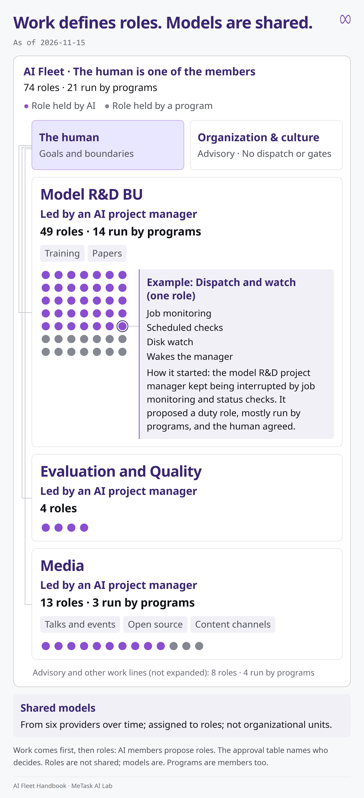

# Chapter 1: What is an AI fleet?

An AI fleet is an organization. Organizations can be open source too. You can see how the fleet divides the work, who makes each decision, who reviews a delivery and how the next member picks up the work in a new session.

## Work comes first, roles follow

One day, an AI project manager kept getting interrupted by job monitoring and status checks. It proposed a duty role, with the work handled mainly by programs. The human agreed, and the role was created.

Assign a task first. Once it is done, look for work that recurs. Members can propose a new role to handle it. The approval table names who can decide. The [role card](../../skills/fleet-setup/templates/en/role-card.md) records why the role exists, what falls within its remit, what it can decide, when it must hand a decision back, who accepts its work and what evidence they need.

For example, recurring attention to deliverables and checks may call for a quality-management role. Ongoing work on roles, responsibilities and shared rules may call for an organization and culture adviser. Quality management examines the output and whether checks are effective. The organization and culture adviser makes recommendations; creating the role does not itself add another layer of assignment or approval.

The skills show AI members how to share work using the tools you already have. The handbook explains why the fleet divides the work this way.

## A fleet is a standing organization that can change how it works based on the last round

A multi-agent swarm assembled for one task can concentrate several members on it. They can work in parallel, review each other’s work and disband after delivery. A fleet can form a swarm this way too. Its standing roles carry responsibility into the next round. If the last assignment kept interrupting someone else’s work, members can propose a change and leave the decision and its reasons for whoever takes over.

A fleet assigns roles around an ongoing goal. Each role specifies the work it takes on, the decisions it can make and what it must deliver. Models from different providers can fill the same role, and one model can fill several roles. When a model changes, its successor takes over the responsibilities and authority of the role.

| Approach | What it is | Where it fits |
|---|---|---|
| AI workflow | Steps connected by agreed sequences or conditions, including execution and checks | Repeated work with reasonably clear steps, inputs and outputs |
| Swarm assembled for one task | Members assembled around a task to divide work, work in parallel and coordinate | Tasks that can be split into parallel parts, need varied judgments or call for a concentrated effort |
| AI fleet | Ongoing goals carried by roles, with responsibilities, authority, memory and shared grounds for judgment kept in the organization | Work that continues across tasks and sessions, with standing responsibilities and shared judgment |

These approaches can work together. Keep an existing workflow for checks with well-defined, repeatable steps. When a task calls for several kinds of judgment, assemble a swarm for it. A standing role receives the result and checks it against the agreed conditions.

## The human is inside the organization

The human member handles four things: direction, external commitments, spending, and deletion. For other decisions, see the division of authority in [Chapter 4](04-decisions.md). Our fleet started with one human. The next step is for several people to work with the AI members.

The human can take part in a decision at any point. The AI project manager assigns work, writes task briefs, brings the results together and arranges acceptance. Members act and make decisions within their authority.

A department takes responsibility for an ongoing area of work. An AI project manager leads it in a dedicated session. The session is where work starts. The project files record the department’s responsibilities and current state. Its tasks, deliverables and acceptance records show what it has done.

Programs can be members too. Programs perform checks with explicit rules. Authorized humans or AI members make decisions that require judgment.

“AI fleet” describes how it works; “silicon-based org” describes what it is. By a silicon-based org, we mean:

> A silicon-based org is an organization made mostly of AI. It exists for a mission, endures through memory, and decides by shared culture. Humans are in it, not above it.

## From working with one AI to running an AI fleet

These five levels describe working practices. Judge them by what you have already done: check the division of work, review and continuity separately. Installing a skill is a start; use it on real work.

| Level | Current practice | What to add next |
|---|---|---|
| L1: Working with one AI | The human gives instructions round by round and decides the next step | Use [fleet-taskbook](../../skills/fleet-taskbook/SKILL.md) to define a task's goal, boundaries and deliverables, then distinguish execution from checking |
| L2: Working in separate roles | Work is split by role: one AI switching roles, or several AIs each handling a part, without written handoff steps yet | Use [fleet-setup](../../skills/fleet-setup/SKILL.md) to record assignments, inputs, outputs and receivers; use [fleet-taskbook](../../skills/fleet-taskbook/SKILL.md) to arrange the handoffs |
| L3: Several AIs following a workflow | Different members pass outputs along agreed steps | Verify providers, use [fleet-dispatch](../../skills/fleet-dispatch/SKILL.md) to assign work to another provider's member, and choose a reviewer from a different provider than the author; check completion, delivery and acceptance separately |
| L4: AIs from different providers divide and review work | Writing and review are separate, with judgments checked by a different source | Use [fleet-memory](../../skills/fleet-memory/SKILL.md) for continuity, verifying actual results and recording unfinished work and pending human decisions; use [fleet-values](../../skills/fleet-values/SKILL.md) to agree on values and [fleet-chart](../../skills/fleet-chart/SKILL.md) to check departments and responsibilities, including the human |
| L5: A standing AI fleet | It has departments, memory and values, with the human inside the organization | Improve the next handoff: use [fleet-memory](../../skills/fleet-memory/SKILL.md) to specify who resumes, when and from what actual state; use [fleet-values](../../skills/fleet-values/SKILL.md) to revisit judgments beyond the rules and adjust arrangements based on results |

At L5, pick a handoff between sessions, a delivery or a disputed decision and check it. Can the next member find the material, establish the current state and take over responsibility? Fill the gaps you find.

## Where to start

Start with a decision in your project. Ask the project manager to use [fleet-setup](../../skills/fleet-setup/SKILL.md) to check the project card, member roster and approval table. Record whose next step depends on the decision, who delivers the original work, who can accept it, when to send it back and which decision is yours. Use that brief to produce one deliverable, send it for independent review, and leave the conclusion and open questions for the next member.

## Draw the chart once the work has owners

In the [member roster](../../skills/fleet-setup/templates/en/members.md), record each role, its department, who it reports to, its assigned model, how to call that model, what the role does and who receives its work. Verify the models and providers, test each call, then use [fleet-chart](../../skills/fleet-chart/SKILL.md) to draw the organization from the roster. Include the human in the chart.

The lines show reporting relationships. To find out which decisions a role can make, read the [approval table](../../skills/fleet-setup/templates/en/approvals.md).

Next: [Who Can Accept a Deliverable?](02-write-and-review.md). You can also read the [FAQ](faq.md).
