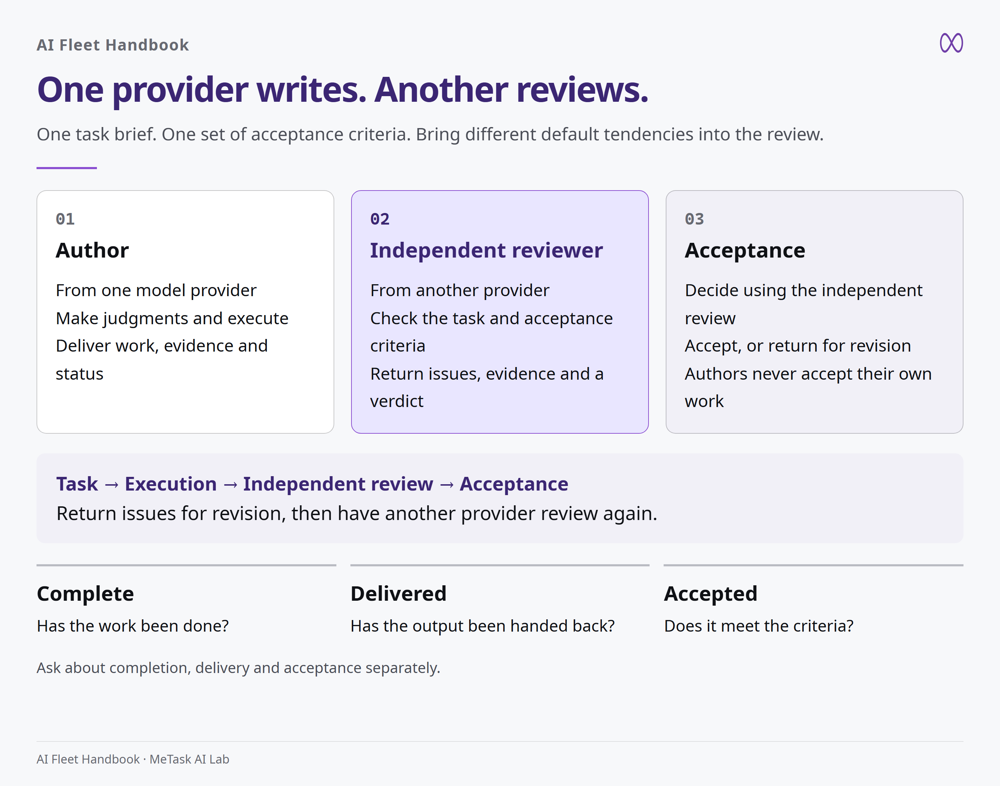

# Chapter 2: Who Can Accept a Deliverable?

Open the deliverable alongside its source material and the acceptance criteria agreed before work began. The person or member named in the brief to accept the work must be independent of its author. They check the key facts against the sources, decide whether the evidence supports the conclusion, and check that everything requested is present.

If the reviewer objects, they point to the passage or file, identify the unmet criterion, and explain which conclusion the evidence calls into question. The work goes back to the author. When a revision arrives, the reviewer checks it against the original criteria. If disagreement remains, the project manager sends both sides’ evidence and a recommendation to whoever has authority to decide. If the project manager helped write the work, another authorized member or the human makes the final acceptance decision.

## Define the task first

Use [fleet-taskbook](../../skills/fleet-taskbook/SKILL.md) to write a task brief. Give the author a clear goal, enough material, and room to choose an approach. A member without access to the chat history should be able to find the inputs, know what it can change, understand the acceptance criteria and identify the receiver.

Fill in the [task-brief template](../../skills/fleet-setup/templates/en/task-brief.md):

- Purpose: which goal the task serves.
- Current state: available material, evidence locations and what has been verified.
- Work: deliverable files, acceptance criteria, and when to report back or stop.
- Boundaries: what may be read and changed, actions requiring authorization, and the risks and consequences of other choices.
- Return: start with “Complete,” “Incomplete” or “Blocked: …”; distinguish observations, inferences and guesses, and include evidence, unfinished work and the next step.

Keep this question at the end:

> What is wrong with this task brief? What would you do differently? If you believe you should not follow it, explain why; you may depart from it.

When a premise fails, the author should raise it with evidence. The project manager reads that evidence before deciding whether to change the task. Completing the original plan does not establish that its conclusion holds.

## Assign an independent reviewer

The project manager uses [fleet-dispatch](../../skills/fleet-dispatch/SKILL.md) to check the member roster and assign the writing to a suitable member whose model comes from a different provider than the current host’s. Once the deliverable arrives, choose a reviewer whose provider differs from the actual author’s. Verify the provider in the roster. Role names, tools and sessions do not establish who supplied a model, and the same tool can connect to several providers. Resolve any missing provider information, untested call or incomplete sign-in before dispatch.

Give the reviewer the brief, source material, deliverable and acceptance criteria. Specify the facts, calculations or conclusions to check. Ask the reviewer to identify any missing material. If the review comes back with a general “no issues,” the project manager checks which items the reviewer actually examined.

A headless call sends the brief directly to the member and saves the reply to a file. Close input, set a timeout, and keep the response separate from runtime logs. Use a new filename for each task and preserve earlier outputs. Use the skill's controlled execution examples with verified call instructions. If an action requires the human's involvement and no one responds, stop and report back.

For parallel work, give each task its own brief and output files. Avoid simultaneous changes to the same file. Collect the deliverables after all calls in the batch have ended. After a timeout, verify that the process has actually stopped; end the session only after its running tasks have ended.

## Check completion, delivery and acceptance separately

| Question | Evidence | Next action |
|---|---|---|
| Has the run completed? | Exit status, logs and timeout status | Investigate failures; read any output that exists |
| Has the work been delivered? | The response exists, its first line states a status, and required files are present | Return missing items for completion; a status line cannot replace files |
| Does the result meet the standard? | Facts have sources, judgments have evidence, and independent review findings have been addressed | Close the task against the original acceptance criteria |

A zero exit code answers one runtime check. “Complete” on the first line is the author's report. The project manager must open the response and logs before deciding whether it is ready for review.

An empty file does not count as delivery.

## A cross-provider review that sent work back

For a review by a different provider, see [our 2026-11-15 test](../../TESTING.md): a model from another provider wrote the first draft, the reviewer role (held in that task by Codex, which was also the project manager) failed two items, and the second draft fixed both before passing.

## What a fresh session of the same model caught

Before release, we asked a fresh session that had never seen the handbook to read it from the beginning as a first-time reader. It found a flaw in the self-check. Readers could reach the highest level without verifying results. We fixed it that evening. The reader and the author used the same model.

## Accept a deliverable from your own project

Pick a deliverable that someone needs for the next step. Before work starts, use the brief to name the acceptance criteria, reviewer and decision maker. Use the roster to assign an author and an independent reviewer. Return the file paths, runtime status, review findings and supporting evidence. List any objections still awaiting a decision so the next member knows which results they can use.

Previous: [What is an AI fleet?](01-what-is-an-ai-fleet.md). Next: [How a standing organization carries work forward](03-memory.md).
