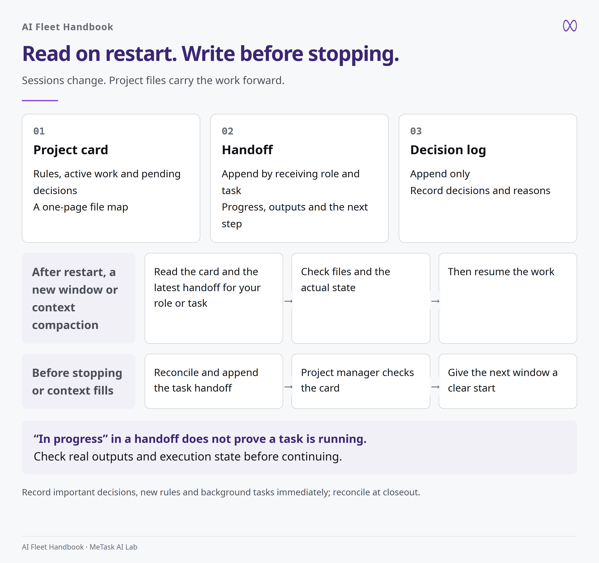

# Chapter 3: How a standing organization carries work forward

Context fills up, and another member may take the next round. The next member needs to find agreed goals, past decisions and unfinished work in files.

**From our fleet**

Once, we stopped using one model; its role switched to another model, and the responsibilities stayed the same. When a session runs out of context and we open a new one, the new session first reads the project card and the latest handoff for its role or task. It checks the actual files, outputs and task state before continuing.

Work memory starts with two habits: read before resuming, write before stopping. After reading, verify the actual state. When writing, make the next step clear to whoever takes over.

## Three records, three purposes

| Record | Location | Contents | Updates |
|---|---|---|---|
| Project card | `AGENTS.md` at the project root | Goals and rules, current work, pending human decisions and a file map | Keep it to one page; the project manager maintains the current state |
| Handoff | `fleet/handoff.md` | Progress, next steps, blockers, who resumes and when | Append only; name the receiving role and task in each heading |
| Decision log | `fleet/decisions.md` | Who decided what, why, supporting evidence and dissent | Append only; link a new decision to the older entry it replaces |

Only the project manager role maintains the project card. Other roles propose changes through handoffs and the decision log.

The project card tells the next member where to look. The handoff identifies the work to take over. The decision log explains why things were decided that way. Keep the history in the latter two; the project card carries only what is needed to resume work.

Create these files with [fleet-setup](../../skills/fleet-setup/SKILL.md), then use [fleet-memory](../../skills/fleet-memory/SKILL.md) to carry work forward. The root `CLAUDE.md` references `AGENTS.md`. A newly created file contains just `@AGENTS.md`. Preserve existing files and maintain only the content or reference in their “AI Fleet Project Card” section. Explicitly read the project card when starting, and verify that the host has loaded the reference.

All these records stay in the project you specify. Tasks and deliverables also point to files inside the project so they can be checked and handed over.

Ask the project manager to check that the project card's first line states these habits: after a restart, session change or context compaction, read the project card and the latest handoff for your role or task, then verify the actual state before acting; record important events as they happen and reconcile the records before stopping.

## Read before resuming, then reconcile the state

After a restart, a session change or context compaction, read the project card and the latest handoff addressed to your role or task first. Locate it by role or task, rather than simply taking the last entry by date. If you cannot tell whether it is meant for you, ask first. Follow the file map to the principles, members and decisions relevant to this task.

Treat a compacted summary as a clue, not as evidence. It may sound complete while omitting lasting rules, running tasks and file conventions. Read the project card and matching handoff, then verify the state before continuing. Where the host supports it, enable an automatic reminder to read and verify these files after context compaction.

Verify actual files, outputs and task state. “In progress” records the previous state; it cannot establish that a task is still running. “Complete” cannot establish that quality has been accepted. Read existing outputs and verification results to distinguish work already done, work awaiting review and work that has yet to happen.

When the state is unclear, record the observations before choosing where to resume. Verify what happened before repeating a step, especially one involving an external action or an irreversible result.

You can ask the project manager:

> Resume this work using fleet-memory. Read the project card and the latest handoff addressed to your role or task, verify existing outputs and task state, then tell me where to continue and what evidence supports that choice.

## Record important events as they happen

Record important human decisions, newly agreed rules and newly started background tasks in the decision log or handoff when they happen. Do not wait until closeout. For a background task, include its identifier, running-state evidence, how to recognize success and failure, and how to resume. A session can end without warning; the next member needs these records to judge the state.

Write important handoffs in files the receiving role or task must read; messages only tell the receiver where to read. If messaging is blocked, continue work within existing authority without waiting for someone to enable messaging.

## Optional: wake up on a schedule

If the tool supports scheduled tasks, members can use them to wake up periodically. On waking, read the project card and the latest handoff for the role or task, verify the state, then continue; keep handoffs in files so this practice works across tools.

Waking up is for moving the work forward, not for taking a look. Three patterns look like self-driven work while the work has in fact stopped:

- Checking only for outside activity, not for the next queued item. On waking, read the next steps first, then look outside.
- Next steps that run only up to a milestone, such as “wait until a set time,” with nothing queued after it. In the handoff, queue the next several items, past the milestone.
- One item waiting for a human's approval, and the whole line waiting with it. Have the project manager record that item under Decisions needed, set it aside, and do other work.

If nothing can be done, write in the handoff why and when you will check again, then ask the project manager to assign work; a project manager with nothing to do tells the human and proposes one or two items to queue next. Do not just wait. The tool's scheduler only wakes members up, and it does not fire while the tool is closed or the computer is asleep. Nothing in this package checks the rest for you: re-queuing work after a milestone, routing items that wait for a human and telling a person when something fails are for members to check using the steps above. Write handoffs that a person can pick up as well.

To have the fleet wake on schedule and move itself forward one round, see [fleet-rounds](../../skills/fleet-rounds/SKILL.md) (experimental).

## Write before stopping so someone can take over

Before stopping or nearing the context limit, append a section using the [handoff template](../../skills/fleet-setup/templates/en/handoff.md). Name the receiving role and task in the section heading. At closeout, reconcile the entries already made and record any state changes; the project manager checks the project card. Include at least:

- Existing outputs and verification results. Distinguish runtime completion, complete delivery and quality acceptance.
- The next queued items, past any milestone, and which to do first if the first one is blocked; also any missing material, authorization or unresolved error.
- Who resumes, when, or under what condition.
- How to recognize success and who receives it; how to recognize failure, what to preserve and who decides what happens next.
- The working directory and preconditions for any continuation command. State explicitly when no command is needed.
- Whether any task is still running, and the evidence that ended tasks have stopped. If none is running, say so.

“Keep improving it” leaves too much to reconstruct. Name the next file, the result to check and the role taking over.

Reopen the handoff after writing it. Check that referenced project paths and command inputs exist. Distinguish observations, inferences and guesses. If evidence is insufficient, say so. List the specific actions awaiting a human decision and your recommendation.

## Preserve the reasons for decisions

For each decision, record the date, decision maker, scope, conditions for taking effect and reasoning. Include dissent, reasons for rejecting alternatives, and which roles need to read it.

Before changing an established decision, find its original reason. If new evidence supports a change to roles or rules, peers review the proposal, then a model from another provider checks it. The role named in the approval table decides. Append the new decision and its reasons and link to the original entry, preserving its text. Later members can then distinguish the premises that held at the time from what has changed since.

After a rule changes, verify that affected members have read the new entry. An updated file and an adopted rule are two separate things to check.

## Check the next handoff

Start a fresh session and give the incoming member the project card. Ask them to find the latest handoff for their role or task and answer three questions using the material in the project.

1. **Where does the work stand?** Open the deliverables and their review or run records. Identify what has been checked and what still awaits review, and show where to verify each claim.
2. **What is still undecided?** Point to an open objection or missing authorization. Name who decides and which step must wait. If nothing is pending, say what can proceed.
3. **Why did the last round take this course?** Find the decision entry, point to the evidence or constraint behind it, and explain how that reason affects the next step.

The handoff works when the incoming member can substantiate all three answers. If an original file is hard to find, ask the project manager to fix the file map. If progress or open decisions are unclear, update the role’s handoff. If a reason is missing, flag the gap in the decision log and ask the original decision maker to verify it.

Previous: [Who Can Accept a Deliverable?](02-write-and-review.md). Next: [Who decides what](04-decisions.md).
