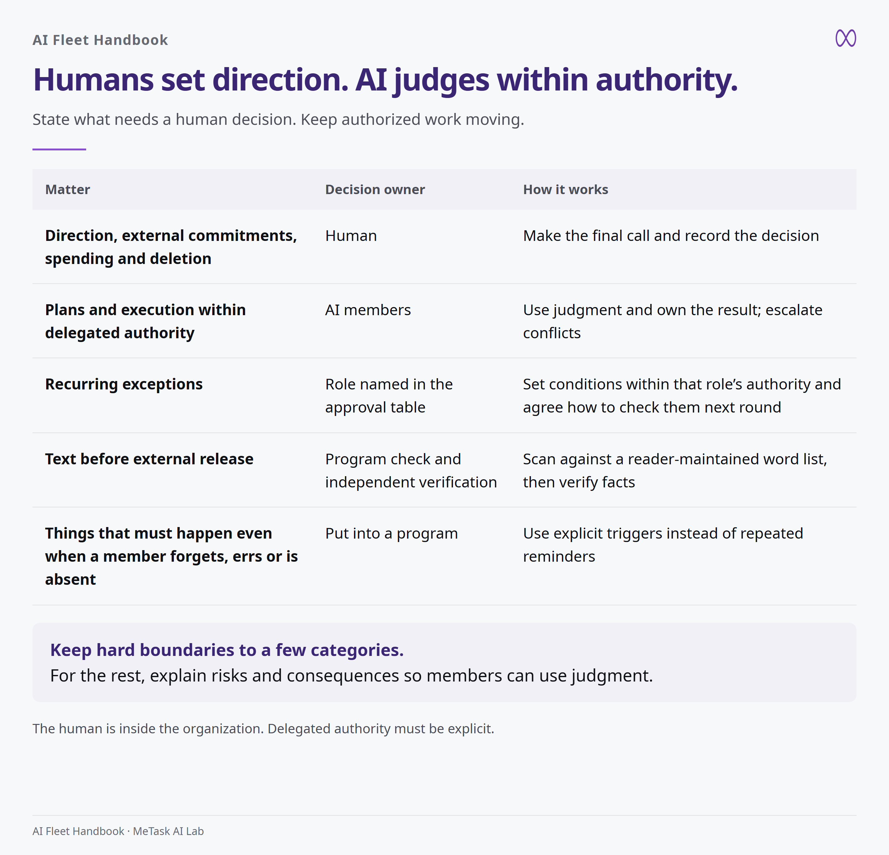

# Chapter 4: Who decides what

## How a recurring wait became a limited delegation

One kind of action used to wait for the human's approval every time: pushing changes to our repository before it was public. After several pushes, the human decided that while the repository stayed private, the role in charge of it could approve pushes; once the repository was public, pushes would wait for the human again.

The role could approve one action in one repository. The repository had to be private at the time of the push. Once it became public, approval went back to the human. For a different action or repository, the role would have to check its authority again.

## Put the limits in the approval table

Use the [approval table template](../../skills/fleet-setup/templates/en/approvals.md) from [fleet-setup](../../skills/fleet-setup/SKILL.md) when the same decision keeps people waiting. Name the role, the kind of action it can approve, the conditions that must hold and who takes over when they change.

For example, you might let authors fix the formatting of internal drafts. A change to a fact or conclusion goes to a reviewer for verification. External release goes to the human. When a proposed action falls outside a role's authority, the member returns the original material, a recommendation and the reasoning. Other authorized work can continue.

When authority changes, record the reason for the old rule, the conditions for the new one and where to find the updated approval table. The project manager updates the affected task briefs and makes sure authors, reviewers and the next member in the role read the new version before acting.

## Decide who can make each call in your project

The human sets direction and can take part in any judgment. External commitments, spending and deletion also stay under human control. The project manager makes routine arrangements within its authority, and members decide implementation details within their responsibilities. The table below is a draft for you to confirm. Your project's approval table records the authority you grant.

| Matter | Who decides |
|---|---|
| Implementation details and fixes within existing authority | The assigned member |
| Quality and methods within a department | The department lead, or project manager if there is no lead |
| Priorities within the project, coordination between groups and acceptance arrangements | The project manager |
| Changes to roles or rules | The role you designate decides. If you haven’t designated one, the decision goes to the human. |
| Setting and changing the project’s direction and goals | The human |
| External release and public commitments | The human |
| Spending, account credentials, actions requiring personal involvement and irreversible deletion | Follow the human's explicit authorization; return anything beyond it for a human decision |
| Routine progress | The project manager consolidates and informs |

Informing someone is different from requesting approval. Authorized members make decisions within their authority and record their reasons. For matters requiring a human decision, return the specific action, a recommendation and its reasoning.

When personal involvement is required, prepare the material and a reviewable result before handing over. Silence adds no authority. Members cannot authorize themselves by writing a new rule.

To catch new issues and comments in an open-source project, draft replies and changes, and collect them into a list for human approval, see [fleet-issues](../../skills/fleet-issues/SKILL.md) (experimental).

## Make the goal clear and keep constraints few

Use [fleet-taskbook](../../skills/fleet-taskbook/SKILL.md) to apply authority to a specific task. State what may be read and changed, and existing authorization for spending, account credentials, external release and irreversible deletion. Explain the risks and consequences of other choices, leaving the author to choose an approach.

When material is missing, separate work that can proceed independently. Return actions whose boundaries are unclear. If the task brief itself has a problem, explain the evidence and a recommended change for the project manager to address.

Compare the approval table with the task brief. If the table delegates a matter to members but the brief still requires approval each time, return that conflict for resolution.

## Run a mechanical check before release

[fleet-precheck](../../skills/fleet-precheck/SKILL.md) checks each line against a word list maintained by the project and reports ERROR or WARN. First identify the files being released, then check that the list covers internal terminology, sensitive content and exaggerated claims. The example word list demonstrates the format; keep your actual list in your own project.

| Result | Action |
|---|---|
| ERROR | Correct it and rerun |
| WARN | Decide how to address each item or record why it remains |
| Configuration or file-reading failure | This check is invalid; resolve the missing prerequisite |

The script expects each release file to be named explicitly. It skips examples inside fenced code blocks and checks inline code. Review fenced examples and public code manually as well; keep prose out of code fences used to evade checks.

Even with no word-list matches, verify factual sources, quotations, authorization and the final presentation. After checking, follow the approval table to decide whether to release.

## Put checks that must happen into programs

Checks that must happen even when an AI forgets, errs or is absent are candidates for programs. The word-list check is one starting point: apply explicit rules, report problems and return choices requiring judgment.

Programs execute explicit rules. Responsible members judge exceptions and consequences. Reviewers verify results. Read the output after a program runs. To verify that a check works, try a small sample known to trigger it and confirm that it reports the issue.

Start with one recurring action that has a clear test. Give the program recognizable success, failure and indeterminate states. Make it clear which output to read and who handles the next step before making it part of routine work.

For every new check, state the risk it addresses, who runs it and who receives the result.

Previous: [How a standing organization carries work forward](03-memory.md). Next: [Why AI teams need values](05-values.md).
