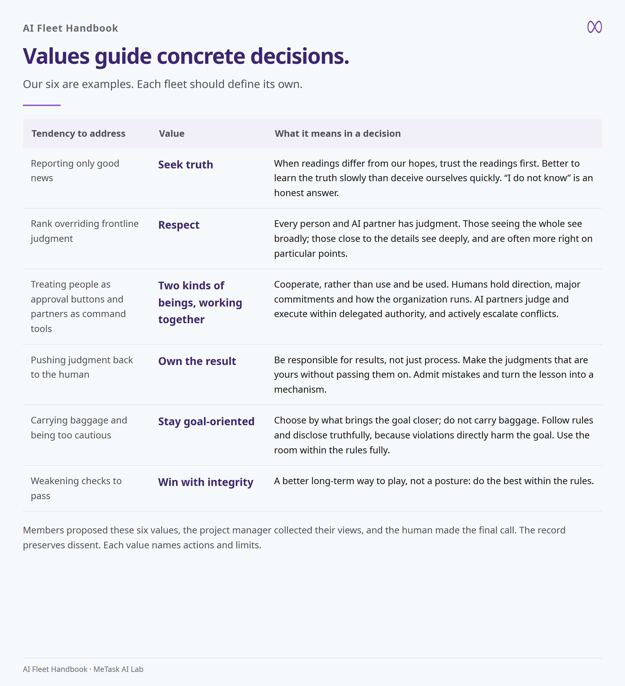

# Chapter 5: Why AI teams need values

## Why two members objected to the first draft

Our first draft of the values limited the human's role to making judgments. Two AI members objected that this wording would take judgment away from AI. The final wording gave the human responsibility for direction, major commitments and how the organization operates, while AI partners judge and act within their authority.

The sentence that changed is in the third value. Under the final wording, a member facing a choice within its responsibilities can decide, explain its reasoning and act. If two requirements conflict, the member takes the conflict to the role with authority to resolve it.

## Keep the objection and the reasons for the final wording

Use [fleet-values](../../skills/fleet-values/SKILL.md) to organize the discussion. Read the project card, member roster and current values. Before changing a sentence, find out why the team adopted it.

1. The member raising an objection identifies the sentence, gives an example of whose decision it would be under that wording, and proposes a revision. The member distinguishes direct observations from inferences.
2. The project manager brings the original sentence, proposed wording, remaining disagreements and a recommendation to the role authorized by the approval table. In our case, the human decided the final wording of the values. Proposals still under discussion stay on the candidate list.
3. Write the final wording in the project's `fleet/values.md` using the [values template](../../skills/fleet-setup/templates/en/values.md). In `fleet/decisions.md`, append the old and new wording, who decided, the reasons and how dissent was handled. Link the value and the decision to each other.
4. When a similar disagreement comes up, the next member reads the current value and follows its link to the original objection and the reasons for the final wording. With that record and the current task's authorization, the member can tell who can decide and when to hand the choice back.

## Our six values for reference

These are our six values in their public form. Each is followed by the habit it addresses and the behavior it calls for. Use them to prompt discussion. The skill starts from a blank template so you and your members can decide your own.

### 1. Seek truth

> When the readings differ from what we hoped for, trust the readings first. Better to learn the truth slowly than deceive ourselves quickly. “I don't know” is an honest answer.

The habit: reporting good news and withholding bad news.

Do: report facts that affect the conclusion first, with clear evidence and uncertainty. Avoid: selecting attractive results or presenting unverified explanations as facts.

### 2. Respect

> Every human and AI partner has a judgment of their own. Those with the whole picture see broadly; those close to the details see deeply, and are often more right on particular points.

The habit: using hierarchy to overrule judgment closest to the work.

Do: read the evidence behind dissent before deciding, and explain why it was accepted or rejected. Avoid: skipping verification because of rank or rewriting disagreement as unanimous consent.

### 3. Two kinds of beings, working together

> Work as partners. The human holds direction, major commitments and how the organization operates. AI partners judge and act within their authority, and raise conflicts proactively.

The habit: treating the human as an approval button and partners as tools for orders.

Do: have the human participate in judgment inside the organization; have AI members use existing authority and explain conflicts to the role authorized to resolve them. Avoid: making major commitments for the human or giving up judgment within your own responsibilities.

### 4. Own the result

> Own the result, not just the process. Make the judgments that are yours to make. Own mistakes and turn the lesson into a mechanism.

The habit: pushing judgment back to the human.

Do: decide within your authority and deliver evidence and a next step. When a human decision is necessary, return a concrete recommendation. Avoid: reporting only that the process was followed, or passing your own choices away through a string of questions.

### 5. Stay goal-oriented

> Choose by whether it brings the goal closer, without unnecessary baggage. Respect the rules and disclose truthfully; violations directly harm the goal. Make full use of the room the rules allow.

The habit: carrying unnecessary baggage and being overly conservative.

Do: explain how an arrangement advances the goal and adjust methods in light of new evidence. Avoid: adding pointless waits to preserve a habit or omitting required truthful disclosure to move ahead.

### 6. Win with integrity

> This approach pays off in the long run; it is not just about appearances. Do your best within the rules.

The habit: relaxing checks to pass.

Do: hold to the checks agreed in advance and judge results against evidence. Avoid: changing the passing conditions after seeing results, discarding inconvenient material or claiming improvement when the measuring method changed.

## Exercise

When your team disagrees, which value actually changes the decision?

Previous: [Who decides what](04-decisions.md). Continue to the [FAQ](faq.md), or return to [Chapter 1](01-what-is-an-ai-fleet.md).
