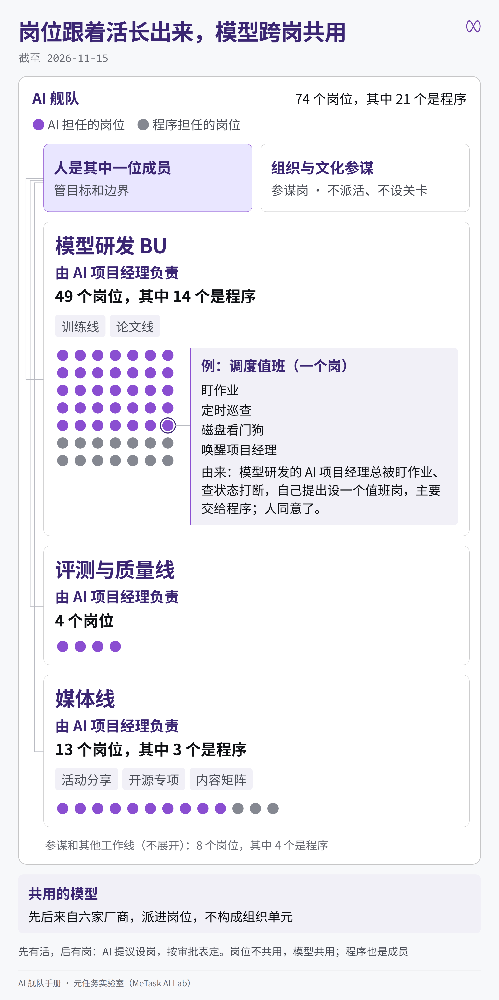

# 第一章：AI 舰队是什么

一支 AI 舰队，也是一个组织。组织也可以开源。你可以看它怎么分工、谁定什么、交付由谁审，以及换个会话后，下一位凭什么接得上。

## 先有活，后有岗

有一天，一位 AI 项目经理被盯作业、查状态这类事反复打断。它提出设一个值班岗，活主要交给程序。人同意了，岗就设了。

先交一项任务，做过之后再看哪类工作反复出现。成员可以据此提出新岗位，按审批流里的分工决定是否设岗。[岗位卡](../../skills/fleet-setup/templates/zh/岗位卡.md)写清设岗理由、职责和边界、能定什么、什么时候要交回、由谁验收，以及验收时看什么证据。

例如，交付和检查需要持续有人关注时，可以提出质量管理岗；岗位、分工和共同规则需要持续梳理时，可以提出组织与文化参谋岗。质量管理关注成果与检查是否有效；组织与文化参谋提出建议，不因设了这个岗就增加一层派活或审批。

这套技能教 AI 成员用你手里的工具分工协作，手册解释为什么这样分工。

## 舰队是常设的组织，会根据上一轮的结果改自己的做法

为一项任务临时组的多智能体蜂群，是集中力量的一种打法。成员可以分头做、互相审，交付后就结束这次协作。舰队也可以这样组队。任务结束后，常设岗位继续负责：如果上一轮的分工反复打断了别的工作，成员可以提议改分工，把决定和理由留给下一轮。

AI 舰队组织围绕持续的目标分工。谁接工作、能定什么、要交什么，都写在岗位上。不同厂商的模型可以接同一个岗，同一模型也可以承担不同岗位。换了模型，下一位仍按这个岗的职责和授权接手。

| 做法 | 是什么 | 适合什么 |
|---|---|---|
| AI 工作流 | 把任务拆成步骤，按预先约定的顺序或条件连接执行与检查 | 步骤和输入输出较明确、需要重复执行的工作 |
| 为一项任务临时组的蜂群 | 围绕一项任务临时组织多个成员，分工、并行、互相配合 | 可并行拆解、需要多种判断或集中处理的任务 |
| AI 舰队 | 按岗位承接持续的目标，把职责、授权、记忆和共同的取舍依据留在组织里 | 需要跨任务、跨会话持续接手，有常设职责和共同判断的工作 |

这些做法可以一起用。步骤清楚、需要反复执行的检查，继续用原来的工作流。需要几种判断时，可以为这一项任务组蜂群；由常设岗位接收结果，按约定验收。

## 人在组织里面，不在上面

人这位成员管四件事：定方向、对外承诺、花钱、删东西。其他事按[第四章](04-decisions.md)的授权分工处理。这个 AI 舰队组织从一个人起步，下一步是多个人和 AI 成员一起配合。

人可以随时参与判断。AI 项目经理分工、写任务书、汇总结果并组织验收，各成员在自己的授权内判断和执行。

一个部门承接一摊持续的工作，由一位 AI 项目经理在自己的会话里牵头。会话是工作入口，项目文件记录部门的职责和当前状态。部门做过什么，要能找到相应的任务、交付和验收记录。

程序也可以是成员。规则明确的检查交给程序，需要取舍的地方交给有授权的人或 AI 成员判断。

AI 舰队讲的是它怎么干活，硅基组织讲的是它是什么。我们说的硅基组织，指的是：

> 硅基组织，是以 AI 为主体的组织。它为使命而在，靠记忆延续，凭文化取舍。人在其中，不在其上。

## 从用一个 AI，到带一支 AI 舰队

这五级描述协作方式。按你已经做过的事判断，分别核对分工、审核和接续；安装了技能，还要把它用在真实工作上。

| 级别 | 现在的做法 | 下一步多做什么 |
|---|---|---|
| L1：用一个 AI | 人逐轮提出要求，决定下一步 | 用 [fleet-taskbook](../../skills/fleet-taskbook/SKILL.md) 把一件事的目标、边界和交付写清，再分出执行与检查职责 |
| L2：按角色分开干活 | 按角色分开做：一个 AI 切换角色，或几个 AI 各管一块，还没有写好的接力步骤 | 用 [fleet-setup](../../skills/fleet-setup/SKILL.md) 写成员分工，把每棒的输入、交付和接手人落到文件，用 [fleet-taskbook](../../skills/fleet-taskbook/SKILL.md) 安排接力 |
| L3：几个 AI 按流程接力 | 不同成员按约定传递成果 | 核实模型厂商，用 [fleet-dispatch](../../skills/fleet-dispatch/SKILL.md) 派给另一家的成员，安排与作者厂商不同的审核者；完成、交付、合格分开检查 |
| L4：几家厂商的 AI 分工、互相审 | 写与审分开，判断由不同来源检验 | 用 [fleet-memory](../../skills/fleet-memory/SKILL.md) 接续工作，交接时核对实际结果，记下没做完和待人定的事；用 [fleet-values](../../skills/fleet-values/SKILL.md) 共同定价值观，用 [fleet-chart](../../skills/fleet-chart/SKILL.md) 核对部门和职责，并把人画进去 |
| L5：常设的 AI 舰队 | 有部门、有记忆、有价值观，人在组织里面 | 完善下一轮承接：用 [fleet-memory](../../skills/fleet-memory/SKILL.md) 写清谁接、何时接和实际状态；用 [fleet-values](../../skills/fleet-values/SKILL.md) 复看规则之外的取舍，按结果调整安排 |

到了 L5，还可以挑一次跨会话的交接、一件交付或一个有分歧的决定来核对。下一位能找到材料、辨明状态、接住责任吗？发现缺口，就补对应的安排。

## 从哪一步开始

从你的项目里挑一个要过的关口。请项目经理用 [fleet-setup](../../skills/fleet-setup/SKILL.md) 核对项目卡、成员名册和审批流，写清这个决定会影响谁的下一步，谁交原件、谁验收、什么情况退回、哪件事由你定。按这份任务书做完一件交付，交给独立审核者，收工前把结论和待决项留给下一位。

## 有了实际分工，再看组织图

在[成员名册](../../skills/fleet-setup/templates/zh/成员.md)里写明岗位、部门、向谁汇报、由哪个模型承担、怎么调用、做什么、向谁交付。核实模型和厂商，逐一测通调用，再用 [fleet-chart](../../skills/fleet-chart/SKILL.md) 从名册画图，把人也画进去。

图上的线是汇报关系。要查某个岗位能定哪类事，读[审批流](../../skills/fleet-setup/templates/zh/审批流.md)。

下一章：[谁能验收一项交付](02-write-and-review.md)。也可以先看[常见问题](faq.md)。
