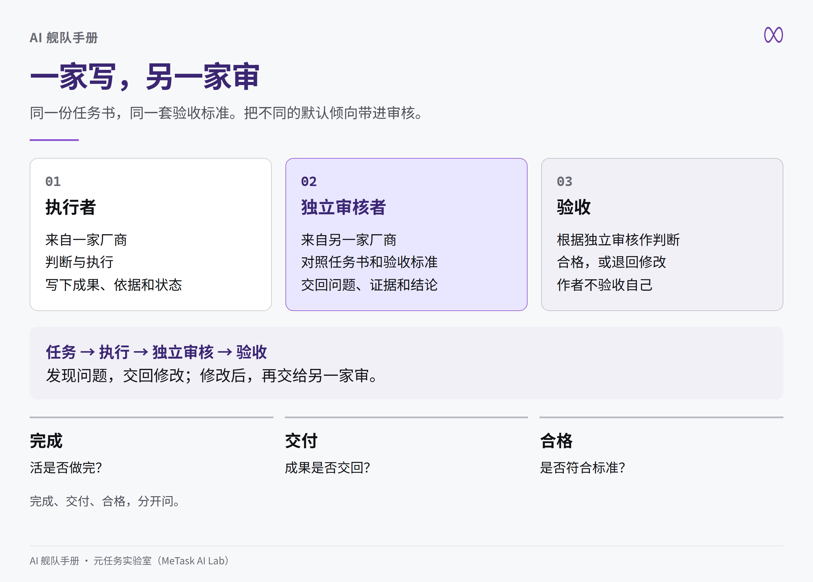

# 第二章：谁能验收一项交付

验收时，把交付原件、它引用的原始材料和开工前定好的验收条件摆在一起。由任务书指定、没有参与写作的验收人打开原件，逐项核对。先核关键事实，再看证据能否支持结论，最后核交付要求。

有异议就指到具体段落或文件，写明哪条条件没过、依据在哪、影响什么结论。把它退给作者。作者交回修订稿后，审核者按原条件复查。双方仍有分歧，项目经理就把双方的依据和自己的建议交给有权裁定的人。项目经理若参与了写作，由另一位获授权的成员或人作最终验收。

## 先把一单写清

用 [fleet-taskbook](../../skills/fleet-taskbook/SKILL.md) 写任务书。给执行者足够的目标和材料，也给它判断方法的空间。任务书要让一个没看过聊天记录的成员找得到输入、知道能改哪里、看得出完成标准，并知道交给谁。

从[任务书模板](../../skills/fleet-setup/templates/zh/任务书.md)填写：

- 为什么：这件事服务哪个目标。
- 现状：已有材料和证据位置，哪些已经核实。
- 要做的：交什么文件，怎样验收，什么时候交回或停止。
- 边界：可读、可写范围；需要授权的动作；其余事项的风险和后果。
- 交回：首行写“完成”“没完成”或“卡在哪”；判断区分“看到的”“推断的”“猜的”，附证据、没做的部分和下一步。

最后保留这一句：

> 这张任务书哪里不对？换你会怎么做？认为不该照做的，写明理由，可以不照做。

执行者发现前提不成立，应该带着证据提出来。项目经理读完再决定是否改任务，不把“按原计划做完”当成结果成立。

## 派给独立审核者

项目经理用 [fleet-dispatch](../../skills/fleet-dispatch/SKILL.md) 查成员名册，把写作交给与当前宿主模型厂商不同的合适成员。收到原件后，再按实际作者的厂商选另一家的审核者。角色名、调用工具和会话都不足以辨认厂商，同一工具也能接不同厂商的模型。名册缺厂商信息、调用没有测通或登录未完成时，先补具体缺口。

给审核者任务书、原始材料、交付原件和验收条件。说明这一单要核哪项事实、哪道计算，或哪条结论与依据的关系。材料缺失时，请它指出缺什么。收到笼统的“没有问题”，项目经理要核对审核者实际查过哪些项。

无头调用把任务书直接交给成员，回复存进文件。调用时关闭输入、设置超时，正文和运行日志分开；每单用新文件名，保留旧交付。技能里有受控执行片段，按已核实的调用方式使用。需要本人操作却无人应答时，停止并交回。

一批任务需要并行时，各自用独立任务书和输出文件，不同时改同一文件。等这批调用全部结束，再收取交付。超时要核对进程确已结束，不能把一个仍在运行的任务留到会话结束。

## 完成、交付、合格，分开问

| 问什么 | 看什么 | 下一步 |
|---|---|---|
| 运行完成了吗 | 退出状态、日志、是否超时 | 异常先定位；有输出也要读内容 |
| 已经交付了吗 | 正文存在、首行有状态、要求的文件齐全 | 缺项交回补齐，不用一句“完成”代替文件 |
| 质量合格了吗 | 事实有出处、判断有依据、独立审核意见已处理 | 对照原来的验收标准收口 |

命令退出为零，只能说明这一项运行检查的结果。交付首行写“完成”，是作者的报告。项目经理要打开正文与日志，再决定能不能进入审核。

空文件不能算交付。

## 跨厂商审核怎样退回

在[2026-11-15 的测试](../../TESTING.zh-CN.md)里，我们的 AI 舰队组织把第一稿交给另一家厂商的模型来写。审核岗（这一单由当项目经理的 Codex 兼着）挑出两处没过审，第二稿都改了才通过。

## 同款模型的新会话查出了什么

发布前，我们请一个没看过这本手册的新会话，当第一次读的人从头读了一遍。它查出自测页的一个漏洞：不核对结果，也能评到最高一级。当晚就修了。这次读手册的和写手册的是同一款模型。

## 验收自己项目里的一项交付

从手上的项目挑一项会影响下一步的交付。开工前，用任务书写清验收条件、谁审、谁有权定。按名册派给作者和独立审核者。最后交回原件路径、运行状态、审核结论和依据，再列出仍待裁定的异议，让下一位知道哪些结果可以用。

上一章：[AI 舰队是什么](01-what-is-an-ai-fleet.md)。下一章：[常设的组织靠什么接得上](03-memory.md)。
