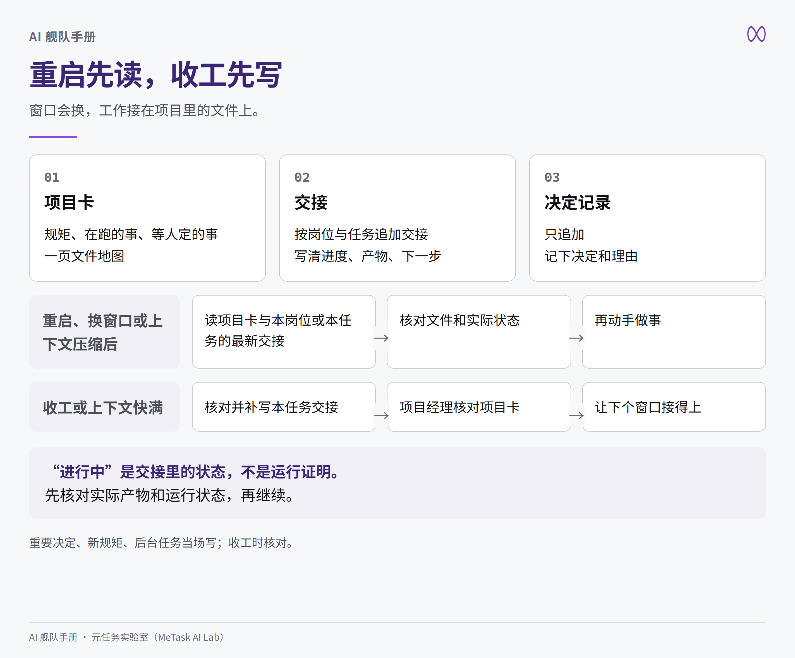

# 第三章：常设的组织靠什么接得上

上下文会满，下一轮也可能换人接手。约定过的目标、做过的决定和还没交完的工作，要让下一位在文件里找到。

**我们的例子**

这个 AI 舰队组织停用过一款模型。另一款模型接了它的岗，职责没动。会话的上下文满了、重开以后，新的一轮先读项目卡和交给本岗位或本任务的最新交接。核对实际文件、输出与任务状态，再接着干。

工作记忆先管两件事：重启先读，收工先写。读完还要核对实际状态；写完还要让接手者知道从哪一步继续。

## 三种记录，各管一件事

| 记录 | 放哪里 | 写什么 | 怎样更新 |
|---|---|---|---|
| 项目卡 | 项目根目录 `AGENTS.md` | 目标与规矩、正在做什么、等人定什么、文件地图 | 保持一页，由项目经理维护当前状态 |
| 交接 | `fleet/交接.md` | 做到哪、下一步、卡在哪、谁接和何时接 | 只在末尾追加，每节标题注明接手岗位与任务 |
| 决定记录 | `fleet/决定.md` | 谁定、定了什么、为什么、依据与不同意见 | 只追加；新决定指向被替代的旧条目 |

项目卡只由项目经理岗位维护，其他岗位通过交接和决定记录提出改动。

项目卡告诉接手者去哪里；交接告诉它接哪一棒；决定记录告诉它为什么这样定。完整历史留在后两者里，项目卡只留恢复工作所需的信息。

用 [fleet-setup](../../skills/fleet-setup/SKILL.md) 初建这些文件，再用 [fleet-memory](../../skills/fleet-memory/SKILL.md) 接续。根目录的 `CLAUDE.md` 引用 `AGENTS.md`。新建文件只写一行 `@AGENTS.md`；已有文件保留原文，只在“AI 舰队项目卡”一节维护正文或引用。开始时显式读项目卡，并核对宿主是否载入引用。

这些记录都在你指定的项目里。任务与交付也指向项目内文件，便于核对和交接。

请项目经理核对项目卡第一行是否写明：重启、切换会话或上下文压缩后，先读项目卡和交给本岗位、本任务的最新交接，和实际状态核对，再动手；重要事项当场记，收工时核对。

## 重启先读，然后对账

重启、切换会话或上下文压缩后，先读项目卡，再读交给本岗位或本任务的最新一节交接，按文件地图读这次任务需要的原则、成员和决定。按岗位和任务找交接，不按时间直接取最后一条；分不清是不是自己的，先问。

压缩后的摘要只当线索，不当依据。它读起来完整，却可能丢掉长期规矩、正在运行的任务和文件惯例。先读项目卡和匹配的交接，核对过再动手。宿主支持的话，让它在压缩后自动提醒先读文件并核对。

核对实际文件、输出与任务状态。“进行中”是上次写下的状态，不能证明任务现在仍在执行；“完成”也不能证明质量已经合格。查看已有交付和验证结果，确定哪些已做、哪些待审、哪些还没发生。

看不清时，先记录看到的事实，再决定从哪一步续接。没有确认前，不把重复执行当成恢复的默认动作，尤其是涉及外部动作或不可撤回结果的步骤。

可以这样向项目经理交代：

> 按 fleet-memory 接续这项工作。先读项目卡和交给本岗位或本任务的最新交接，核对现有产物与任务状态，再告诉我从哪一步继续、依据是什么。

## 重要的事当场写

人的重要决定、新定的规矩、刚启动的后台任务，发生时就写进决定记录或交接，不攒到收工。后台任务写明任务标识、运行证据、怎样识别成功与失败，以及续接方式。会话可能随时中断，下一位需要靠这些记录判断。

重要交接写进接手岗位或任务必读的文件，消息只通知对方去哪里读。消息受阻时，继续做授权范围内可做的工作，不等人来开通消息。

## 可选：定时醒来

工具支持定时任务时，可以让成员定时醒来。醒来先读项目卡和交给本岗位或本任务的最新交接，核对状态再继续；交接都写进文件，做法不绑某一种工具。

醒来是为了接着干，不是为了看一眼。下面三种情况，看着像在自己往前推，其实活停着：

- 只看外面有没有新动静，不看手上排着的下一件。醒来先看“下一步”，再看外面。
- “下一步”只写到某个节点（比如“到某个时刻再说”），节点之后就空了。交接里把接下来的几件都排上，排到节点之后。
- 一件事等人点头，整条线跟着停。等人定的那件交项目经理记进“等我定”，先放着，接着做别的。

真没有能做的，在交接里写明为什么、几点再看，再告诉项目经理，请它排活；项目经理自己没活可做，就告诉人，并提一两件可以接着排的活。不要只等。定时靠工具本身，它只负责叫醒，工具没开、电脑睡着时也不会醒。节点做完以后重新排活、等人的事分流、出了错告诉人，本包没有程序替你盯，要成员照上面几条自己查；交接也要写到人回来能接上。

想让舰队按时醒来、自己往前推一轮，见 [fleet-rounds](../../skills/fleet-rounds/SKILL.zh.md)（试用）。

## 收工先写，让下一位能接

收工或上下文快满时，按[交接模板](../../skills/fleet-setup/templates/zh/交接.md)向末尾追加一节，标题写明接手岗位和任务。收工时核对当场记录是否齐全、状态是否有变化；项目经理核对项目卡。至少写清这些事：

- 已有的产物与验证结果；运行完成、交付齐全、质量合格分别写。
- 接下来排着的几件，排到节点之后，写明第一件卡住时先做哪件；以及缺材料、缺授权或异常在哪里。
- 谁接，何时接，或者什么条件满足后接。
- 成功怎样识别、接下来交谁；失败怎样识别、保留什么、交谁判断。
- 恢复命令的工作目录、执行前的核对条件；无需运行就写明。
- 现在是否有任务在运行，用什么证据确认已结束；没有就写没有。

“继续完善”不足以接手。写出下一个文件、要检查的结果和接手岗位，下一位才知道先做哪件事。

写完重新打开，核对引用的项目内路径和命令输入确实存在。判断分为看到的、推断的、猜的；证据不足就写证据不足。把等人定的具体动作及倾向列出来。

## 决定留下理由

决定记录保留日期、谁定、适用范围、生效条件和理由。不同意见、未采纳的理由、哪些岗位需要读到，都写进同一条记录。

改一个已定事项前，先找当时为什么这样定。新证据支持改分工或规矩时，先把建议交给同伴互审，再换一家模型复核，由审批流里有权的岗位决定。把新决定和理由追加到记录里，指向旧条目并保留原文。后来的成员可以据此分清当时成立的前提和现在发生的变化。

规则变了，还要确认受影响成员读到的是新条目。文件已经更新和成员已经采用，是两件需要分别核对的事。

## 下一轮承接怎么验

另开一个会话，把项目卡交给接手者。让它找到写给本岗位或本任务的最新交接，只凭项目里的材料核对三件事。

1. **现在做到哪了？** 打开交付文件和相应的审核或运行记录，指出哪些已经验过，哪些还在等审，给出能复核的位置。
2. **哪件事还没定？** 指出未决的异议或缺少的授权，说清由谁定、哪一步要等。没有待决定的事，就指出接下来可以做什么。
3. **上一轮为什么这么定？** 找到那条决定，指回当时采用的证据或约束，说明这个理由怎样影响眼前的下一步。

三问都能指回实物和记录，接手者就能继续。找不到原件，请项目经理补项目卡的文件地图。实际进度或待决项说不清，补本岗位的交接。找不到旧理由，就在决定记录中标出缺口，请当时作决定的人核实。

上一章：[谁能验收一项交付](02-write-and-review.md)。下一章：[谁定什么](04-decisions.md)。
