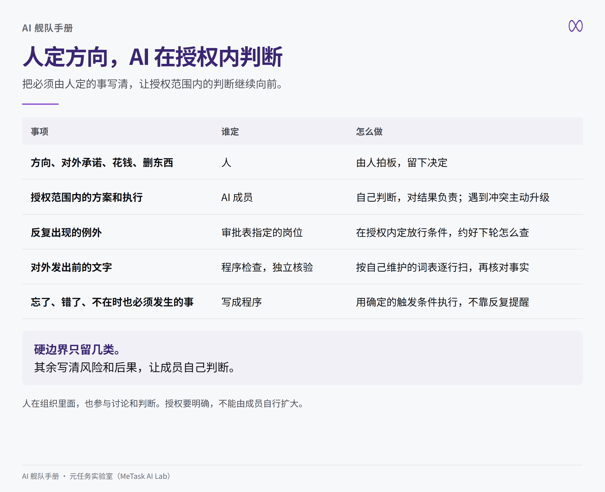

# 第四章：谁定什么

## 重复等待怎样变成有限授权

有一类事，原来每次都等人点头：把改动推到还没公开的仓库。推过几次以后，人定了：仓库没公开时，管这件事的岗位批了就推；公开以后，照旧等人。

这条授权只管向那个仓库推送改动。仓库仍是私有时，由负责它的岗位批准推送。仓库一公开，批准权就交回给人。换一件事、换一个仓库，都得另查授权。

## 把授权写进审批流

用 [fleet-setup](../../skills/fleet-setup/SKILL.md) 的[审批流模板](../../skills/fleet-setup/templates/zh/审批流.md)记下这类等待。写清哪一个岗位可以定哪一类事、在什么条件下有效，以及条件变化后交回给谁。

例如，你可以让执行者直接改项目内文稿的格式。涉及事实或结论，交审核者核实；要对外发出，再交给人决定。碰到超出授权的动作，成员带着原件、倾向和理由交回，其他已获准的工作可以继续。

授权变了，把旧理由、生效条件和新版审批流的位置写进决定记录。项目经理同步受影响的任务书，让执行者、审核者和接手这一岗的成员在下次行动前读到新版。

## 按你的项目确定谁来定

人定方向，可以随时参与判断。对外承诺、花钱、删除东西也由人把关。日常安排由项目经理在授权内决定，实现细节交给负责的成员。下面是供你确认的分工草案，授权以你项目的审批流为准。

| 事项 | 谁定 |
|---|---|
| 已有授权内的实现细节与修复 | 执行成员 |
| 部门内的质量与方法 | 部门负责人；未设时由项目经理 |
| 项目内先后次序、跨组协调和验收安排 | 项目经理 |
| 改分工、改规矩 | 由你指定的岗位定。还没指定的，交给人。 |
| 项目方向和目标的定稿和变更 | 人 |
| 对外发出和公开承诺 | 人 |
| 花钱、账号凭据、需要本人操作、不可撤回的删除 | 按人的明确授权；超出授权交人定 |
| 例行进展 | 项目经理汇总知会 |

知会不等于审批。已给授权内的决定，由有权的成员作出并写明理由；需要人决定的事，交回具体动作、倾向和理由。

需要本人操作的环节，把材料和可核对的结果准备齐再交回。人的沉默不增加权限，成员也不能用自己写下的一条新规则给自己授权。

维护开源项目时，想接住新 issue 和评论、起草回复和改动，再汇成清单交人点头，见 [fleet-issues](../../skills/fleet-issues/SKILL.zh.md)（试用）。

## 目标写清，约束写少

用 [fleet-taskbook](../../skills/fleet-taskbook/SKILL.md) 把权限落到这一单：允许读什么、写哪里，花钱、账号凭据、对外发出、不可撤回删除分别有哪些既有授权。其余事项说明风险与后果，由执行者选择实现办法。

缺材料时，拆出可以独立做的部分；边界不清的动作先交回。发现任务书本身有问题，带依据说明为什么、倾向怎么改，让项目经理处理。

把审批流和任务书放在一起核对。表里已经授权给成员的事，任务书还要求逐次请示，就把冲突交回处理。

## 发出前，机械扫一遍

[fleet-precheck](../../skills/fleet-precheck/SKILL.md) 用项目自己维护的词表逐行检查，报告 ERROR 或 WARN。先确定本次会发出的文件，再确定词表覆盖内部用语、敏感内容和夸大说法。示例词表只展示格式，真实词表留在你自己的项目内。

| 检查结果 | 怎样处理 |
|---|---|
| ERROR | 修正后重跑 |
| WARN | 逐项确认处理办法或保留理由 |
| 配置或文件读取失败 | 本次检查无效，先补缺口 |

脚本不递归替你寻找发布材料，要明确给出每个文件。代码围栏内的示例会跳过，行内代码仍检查；另须人工核对围栏和对外代码，不能用围栏藏正文。

没有命中词表，还要核对事实出处、引用、授权和最终呈现。检查通过之后，按审批流决定是否发出。

## 必须发生的事，写成程序

AI 忘了、错了、不在时也必须发生的检查，适合交给程序。发前词表检查就是一个入口：按明确规则报告问题，把需要取舍的地方交回。

程序负责执行明确规则，负责人判断异常和后果，审核者核对成果。程序运行了，也要看输出本身；要验证检查有效，可以用一个已知会命中的小样本试一次，确认它会报告。

起步先选一个重复且可明确判断的动作。程序有可识别的成功、失败和无法判断状态，下一位知道该读哪个输出、由谁接着处理，再把它放进日常工作。

每加一道检查，都写清它守住哪种风险、由谁执行、结果交给谁。

上一章：[常设的组织靠什么接得上](03-memory.md)。下一章：[AI 团队为什么要价值观](05-values.md)。
